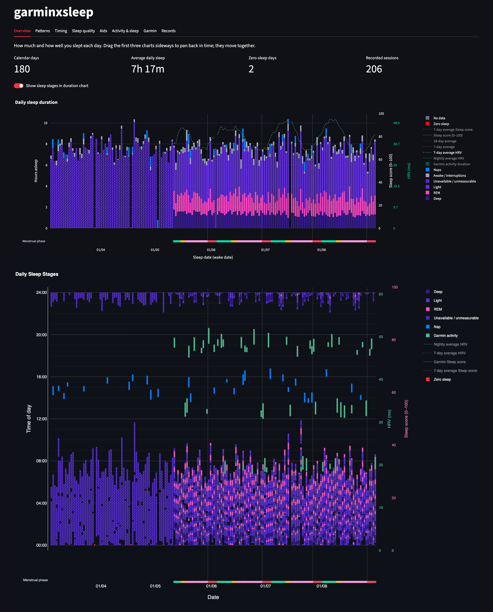
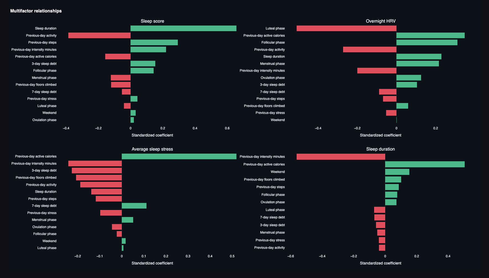

# garminxsleep

A local dashboard that combines historical Sleepmeter records with Garmin
Connect sleep, HRV, activity, and health data. It visualizes how sleep relates
to training load, bedtime regularity, sleep debt, sleep aids, and the menstrual
cycle.

[**Open the live demo →**](https://garminxsleep.streamlit.app/)

The hosted demo uses generated synthetic data. It contains no Garmin
credentials or personal health records, and the project runs locally without
connecting an account.





## Contents

1. [Quick start](#quick-start)
2. [Use your own data](#use-your-own-data)
3. [Sync Garmin data](#sync-garmin-data)
4. [Desktop app (macOS)](#desktop-app-macos)
5. [How the data is merged](#how-the-data-is-merged)
6. [Development](#development)

## Quick start

Requires Python 3.12 or newer.

```bash
python3 -m venv .venv
source .venv/bin/activate
python -m pip install -e ".[dev]"
streamlit run dashboard/app.py
```

This opens the dashboard on the sample data in `sample_data/`: about three
months of invented Sleepmeter history and three and a half months of invented
Garmin data, overlapping by two weeks.

## Use your own data

Create a folder with the same layout as `sample_data/`, then point
`GARMINXSLEEP_DATA_DIR` at it:

```text
private/
├── settings.json              settings (below)
├── sleep_history_*.csv        Sleepmeter export (the newest file is used)
├── aid_colors.json            optional chart colour per sleep aid
├── garmin_*_overrides.json    optional manual corrections
└── raw/<collector>/*.json     written by the Garmin sync
```

```bash
export GARMINXSLEEP_DATA_DIR="$PWD/private"
streamlit run dashboard/app.py
```

### Settings

Every setting in `settings.json` is optional:

```json
{
  "timezone": "Area/City",
  "garmin_start_date": "YYYY-MM-DD",
  "sleep_target_hours": 8,
  "daytime_activity_window": ["09:00", "17:00"]
}
```

| Setting                   | Default            | Used for                                                 |
| ------------------------- | ------------------ | -------------------------------------------------------- |
| `timezone`                | `UTC`              | Showing Garmin's UTC timestamps as local time            |
| `garmin_start_date`       | first Garmin night | When Garmin takes over from Sleepmeter                   |
| `sleep_target_hours`      | `8`                | Target lines, the credit/debit default, sleep debt       |
| `daytime_activity_window` | `09:00`–`17:00`    | Activities left out of the "excluding daytime" gap chart |

Dates are written `YYYY-MM-DD` (for example `2026-01-01`) and times `HH:MM`
in 24-hour format (for example `07:30`).

## Sync Garmin data

```bash
python -m pip install -e ".[sync]"
python -m dashboard.garmin_sync
```

This checks the last three days and downloads only what's new or may still
change: last night's sleep, yesterday's totals once the day has ended, and
anything saved empty because the watch hadn't synced yet. Days already saved
complete aren't downloaded again. The first run asks for your Garmin email,
password, and MFA code. The password isn't saved; a reusable token and the raw
JSON responses go into your data folder. Requests are sequential, at least one
second apart, and capped per run. A Garmin `429` stops the run immediately.

Other runs:

```bash
python -m dashboard.garmin_sync --profile weekly                 # body, VO2 max, cycle data
python -m dashboard.garmin_sync --start YYYY-MM-DD --end YYYY-MM-DD --profile backfill
python -m dashboard.garmin_sync --include sleep --days 7          # one collector
```

Collectors: `sleep`, `hrv`, `daily_health`, `body`, `activities`, `training`,
`menstrual`.

### Every day, automatically (macOS)

```bash
scripts/install_daily_sync.sh HH:MM
```

- Runs the sync daily at that time with your saved token, logging to `sync.log`
  in your data folder.
- Also runs at login, so if the Mac was off it catches up on missed days (up
  to 60 days back).
- Does nothing if a complete sync ran in the last 20 hours.
- If the token has expired the run fails instead of waiting for a password;
  run `python -m dashboard.garmin_sync` once yourself to log in again.

Remove it with `scripts/install_daily_sync.sh --uninstall`.

## Desktop app (macOS)

Open the dashboard in its own window instead of from the terminal:

```bash
.venv/bin/pip install -e ".[app]"
scripts/install_app.sh
```

This adds **GarminxSleep** to your Applications folder; drag it to the Dock to
keep it there. The server starts when you open the app and stops when you close
the window, so nothing runs in the background. It uses `GARMINXSLEEP_DATA_DIR`
(default `private/`). Remove it with `scripts/install_app.sh --uninstall`.

## How the data is merged

- **Before the Garmin start date**, nights come from Sleepmeter. A Garmin night
  that starts and ends within two minutes of a Sleepmeter night is matched to
  it, and its sleep stages are mapped onto that session. Parts Garmin didn't
  cover are marked "stage unavailable" rather than guessed.
- **From the Garmin start date**, Garmin is authoritative. Sleepmeter only
  fills nights Garmin missed.
- Garmin timestamps are UTC and are shown in the configured time zone.
- Sleepmeter interruptions ("holes") reduce asleep time without changing the
  session's start and end.
- Optional JSON override files correct individual nights by hand.

The merged dataset is also exported to `data/sleep_dashboard.duckdb` for SQL
analysis.

## Development

```text
dashboard/
├── app.py          entry point: loads data, date range, renders the tabs
├── config.py       data folder and settings.json
├── data.py         finding, loading and caching the dataset
├── model.py        parsing and merging Sleepmeter and Garmin data
├── storage.py      DuckDB export
├── ui.py           chart defaults, linked panning, formatting
├── garmin_sync.py  Garmin Connect downloader
├── desktop.py      desktop window for the macOS app
├── tabs/           one module per tab, each with render(view)
└── charts/         Plotly figures, one module per tab plus shared common.py
```

Run the tests:

```bash
pytest
```

They run on `sample_data/` and check the merge rules: session and daily totals
agree, no night is counted twice, Garmin naps become sessions, nights Garmin
missed fall back to Sleepmeter, and hindrance charts use only Sleepmeter nights.

Regenerate the sample data (seeded, so the output is identical every run):

```bash
python scripts/generate_sample_data.py
```
